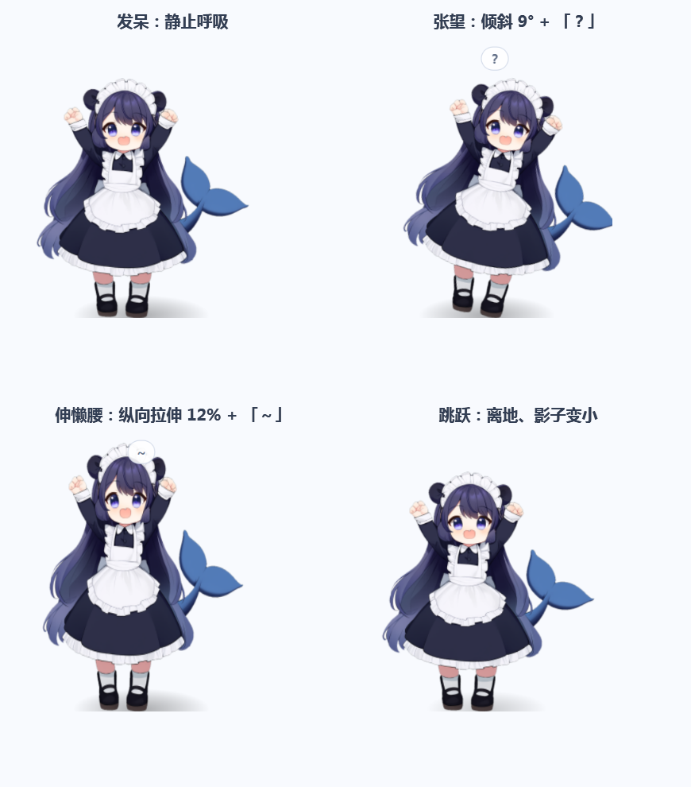
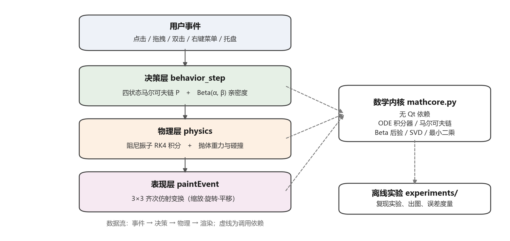

# WhalePet · 鲸鱼女仆娘桌宠

> 一个用数学驱动的 Windows 桌面宠物。无边框透明、可拖拽、可甩飞、会自己发呆张望，
> 还能把文件拖给它"吃掉"——真正移入回收站。
>
> A math-driven Windows desktop pet built with PySide6. No GPU, no cloud, no Python required
> if you use the standalone exe.


---

## 特性

- **无边框透明窗口**：逐像素透明、置顶、不占任务栏，四档尺寸（0.7× / 1.0× / 1.3× / 1.7×）
- **实时动画**：呼吸、摇摆、上下浮动、挤压回弹，全部由数学实时生成，不用序列帧
- **四种自主状态**：发呆 / 张望 / 跳跃 / 伸懒腰，画面姿态可辨认，由马尔可夫链调度
- **甩出去**：拖动后松手按轨迹速度抛出，撞屏幕四边反弹，落点画虚线圈提示
- **拖文件喂食**：文件/文件夹拖到它身上 → 移入 Windows 回收站 + 播放进食动画
- **亲密度**：Beta 共轭先验在线估计，戳得越多越黏人，冷落会掉
- **状态持久化**：位置、尺寸、置顶、落地模式、亲密度全部保存在 `pet_config.json`
- **单文件分发**：PyInstaller 打包 57 MB exe，目标机器不需要 Python

## 截图

**四种自主状态**（发呆 / 张望 / 伸懒腰 / 跳跃）：



**拖文件喂食**（悬停提示 → 图标飞入 → 咀嚼 → 打嗝）：


**系统架构**：



## 数学内核

这个项目刻意避免"调参直到好看"，每个动作都能追溯到一条可推导的规则。核心数学都在
[`mathcore.py`](mathcore.py) 里，不依赖 Qt，可以单独跑实验。

| 环节 | 数学工具 | 实测效果 |
|---|---|---|
| 每帧姿态合成 | 3×3 齐次仿射变换矩阵复合 | 把缩放/旋转/平移折叠为一次乘法 |
| 落地挤压回弹 | 阻尼振子 `m·x'' + c·x' + k·x = 0` + RK4 | 2 s 内相对能量漂移 **+1835.8% → −0.0026%**（vs 显式欧拉） |
| 自主行为调度 | 四状态马尔可夫链 + 幂迭代求平稳分布 | 20 万次仿真访问频率与 π 的 **L1 = 0.0027** |
| 亲密度 | Beta–二项共轭先验 | 200 次交互后均值 **0.730**（真值 0.72），sd 0.031 |
| 拖拽落点预测 | 二次多项式最小二乘 + 抛体解析解 | 800 次仿真 **MAE 35.2 px**，末速外推是 1244 px |
| 喂食动画轨迹 | 二次贝塞尔曲线参数化 | 图标先上扬再落进嘴里 |
| 立绘存储评估 | SVD 截断低秩 + PSNR | 结论：高频立绘不适合低秩压缩（35 dB 需 89% 参数量），alpha 掩膜可以（k=32, IoU 0.994） |

单帧数学计算耗时 **17.4 μs**，占 20 ms 帧预算的 0.09%。

> 全部数字都能用 `experiments/run_experiments.py` 一键复现，见下方「复现实验」。

## 快速开始

### 方式一：直接用 exe（推荐给普通用户）

1. 到 [Releases](https://github.com/HowardHH121/whale-maid-pet/releases) 下载 `WhalePet.exe`
2. 放到**可写目录**（桌面、D 盘、U 盘都行，别放 `C:\Program Files`）
3. 双击运行。首次会弹 Windows SmartScreen，点「更多信息 → 仍要运行」

> 启动约 1–3 s（onefile 要解压到 `%TEMP%`）。无签名 exe 可能被杀软误报，加白名单即可。

### 方式二：从源码运行

```bash
git clone https://github.com/HowardHH121/whale-maid-pet.git
cd whale-maid-pet
pip install -r requirements.txt
python pet.py
```

环境：Windows 10 1809+ / Windows 11，64 位，Python 3.12。

## 使用说明

| 操作 | 效果 |
|---|---|
| 左键拖动 | 移动；快速拖动后松手 = 甩出去，落点显示虚线圈 |
| 左键单击 | 被戳：压扁 + 冒泡 + 亲密度 +1 |
| 左键双击 | 鼓成球 + 6 个气泡 |
| 拖入文件 | 移入回收站 + 播放进食动画（可在右键菜单关闭） |
| 右键 | 戳一下 / 亲密度与当前状态 / 重置亲密度 / 大小 / 置顶 / 落地模式 / 隐藏 / 退出 |
| 托盘图标 | 左键唤回，右键菜单 |

### ⚠️ 关于"喂食"

拖进去的文件会被**真正移入回收站**（`SHFileOperationW` + `FOF_ALLOWUNDO`），可以还原，但不是复制。

代码里有三道护栏，请勿移除：

- 拒绝盘符根目录（`C:\`、`D:\` …）
- 拒绝程序自身所在目录
- 拒绝网络盘（网络共享没有回收站，会退化成永久删除）

如果你 fork 后要改这块，请保留上述判断。

## 打包 exe

```bash
python -m PyInstaller --noconfirm --onefile --windowed ^
  --name WhalePet --icon app.ico --add-data "pet.png;." pet.py
```

产物在 `dist/WhalePet.exe`（约 57 MB）。

## 复现实验

```bash
python experiments/run_experiments.py
python experiments/make_arch.py
```

输出 `figs/metrics.json` 与若干 PNG，README 里的每个数字都能在 `metrics.json` 找到对应字段。

## 项目结构

```
.
├── pet.py                     # 主程序：窗口、绘制、事件、状态机（约 660 行）
├── mathcore.py                # 数学内核：积分器/马尔可夫链/Beta 先验/SVD/最小二乘
├── pet.png                    # 立绘（见下方声明）
├── app.ico                    # 程序图标
├── experiments/
│   ├── run_experiments.py     # 四组对比实验 + 出图
│   └── make_arch.py           # 生成架构图
├── screenshots/               # README 用截图
├── cutout.py                  # 白底立绘抠图工具
└── requirements.txt
```

## 已知限制

- 仅 Windows（回收站、DWM 去描边、Win32 拖动都依赖 Windows API）
- 不支持 32 位 / ARM64 Windows
- 一阶马尔可夫链无法表达"连续跳两次会腻"，后续可换二阶链或 HMM
- 立绘是静态图，眼睛不能追鼠标

## Roadmap

- [ ] 全局热键唤回（隐藏后目前只能靠托盘）
- [ ] 开机自启
- [ ] 眨眼（双图交替）
- [ ] 二阶行为链
- [ ] 可替换的宠物皮肤包

## 致谢与声明

- 形象灵感来自 **DeepSeek 官方 logo / 吉祥物（深海鲸鱼）**，本项目是在其基础上做的
  **拟人化二次创作（fan art）**，仅用于个人学习与娱乐，**不用于商业用途**，
  与 DeepSeek 官方无任何关联，也不代表官方立场。
- 立绘由 AI 绘图工具生成后经程序抠图处理。**美术资源的权利归原作者/权利方所有**，
  不在本仓库的 MIT 许可范围内；如权利方提出异议会立即移除。
- 如果你要 fork 并公开使用，建议把 `pet.png` 换成自己的原创形象。

## License

代码采用 [MIT License](LICENSE)。`pet.png`、`app.ico`、`screenshots/` 等美术资源除外（见上）。
